<p align="center">
  <picture>
    <source media="(prefers-color-scheme: dark)" srcset="docs/assets/banner-dark.svg">
    
  </picture>
</p>

<p align="center">
  <b>Open-source 3D flight planner for drone cinematography, built on CesiumJS.</b><br>
  Plan a shot on a 3D globe, aim the camera exactly, see what the drone will see,<br>
  render a previz video, and export the mission to your drone.
</p>

<p align="center">
  <a href="LICENSE"></a>
  
  
  
  
  
</p>

<p align="center">
  <a href="#-features">Features</a> ·
  <a href="#-tour">Tour</a> ·
  <a href="#-getting-started">Getting started</a> ·
  <a href="#%EF%B8%8F-keyboard-shortcuts">Shortcuts</a> ·
  <a href="docs/exports.md">Export formats</a> ·
  <a href="docs/architecture.md">Architecture</a> ·
  <a href="CONTRIBUTING.md">Contributing</a>
</p>

<p align="center">
  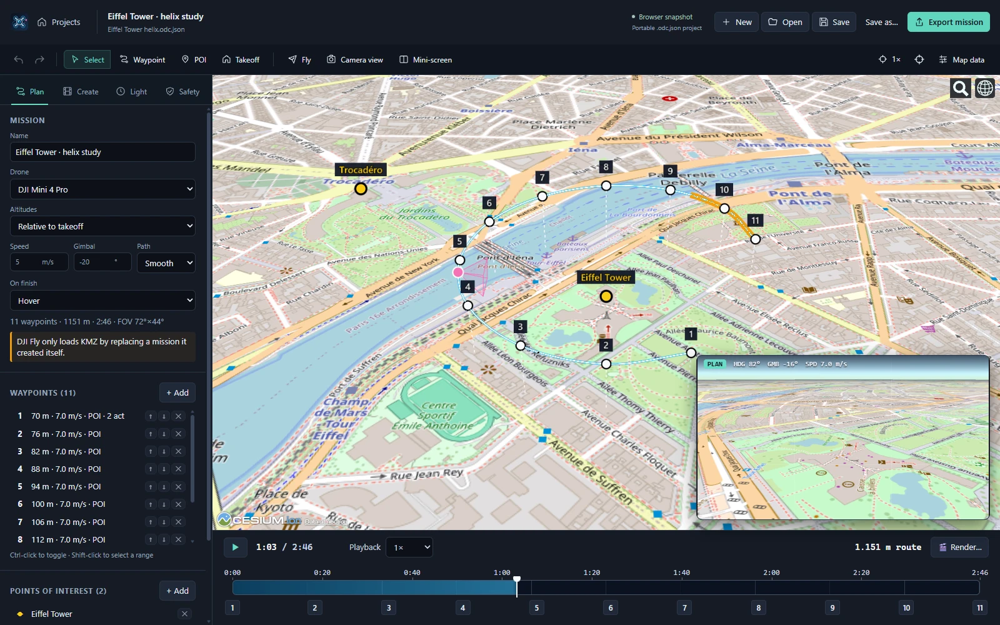
</p>

> [!WARNING]
> **Early development.** OpenDroneCinematic plans flights for real aircraft. Test every exported mission in a safe, open area with plenty of height before you fly it near people or obstacles, and always follow your local airspace rules.

---

## ✨ Features

| Feature                        | What it does                                                                                                                |
| ------------------------------ | --------------------------------------------------------------------------------------------------------------------------- |
| 🌍 **Plan on a real 3D globe** | Cesium World Terrain, aerial imagery, OSM Buildings, Google Photorealistic 3D Tiles, or your own photogrammetry.            |
| 🎯 **Aim the camera exactly**  | Points of interest, heading and gimbal modes per waypoint, smooth easing between them.                                      |
| 🎥 **See what the drone sees** | A live camera view using the drone's real field of view. Swap it with the map at any time.                                  |
| ☀️ **Sun and golden hour**     | Real sun lighting and shadows for the shoot date and time, golden and blue hour on a day strip, and the light on your shot. |
| 🕹️ **Fly mode**                | Fly a simulated drone with keyboard, mouse or gamepad. Drop waypoints, mark POIs, or record a flight path.                  |
| 🎬 **Shot templates**          | Orbit, helix, reveal, dolly, fly-by and dronie, generated around a subject in one click.                                    |
| 🗺️ **Survey grids**            | Draw an area, set height and overlap, get a lawnmower grid with GSD, photo count and distance-triggered photos.             |
| 🛡️ **Safety checks**           | Terrain and building clearance, 120 m ceiling, range, speed, climb rate and battery.                                        |
| 📤 **Export to your drone**    | Litchi CSV, DJI WPML/KMZ, QGroundControl `.plan` and Mission Planner, with an option to match the preview.                  |
| 📥 **Import missions**         | Open Litchi CSV, DJI KMZ, QGC `.plan` and Mission Planner files to preview, edit and re-export them.                        |
| ⛰️ **GeoTIFF terrain**         | Load your own elevation model (SRTM, Copernicus, lidar) for offline terrain, safety checks and terrain following.           |
| 🎞️ **Render previz video**     | Frame-exact MP4, WebM or GIF at up to 4K. Compare takes side by side with the live view.                                    |

---

## 🧭 Tour

### 1. Plan on a real 3D globe

Click **Waypoint** (`W`) and then click the globe to add waypoints, or click **POI** (`P`) to mark what the camera should look at. Drag any waypoint, POI or the takeoff point (`T`) to move it. The flight path is a smooth spline through your waypoints, and each waypoint has a dashed stem down to the ground so you can read its height in 3D.

<table>
  <tr>
    <td width="50%" valign="top">
      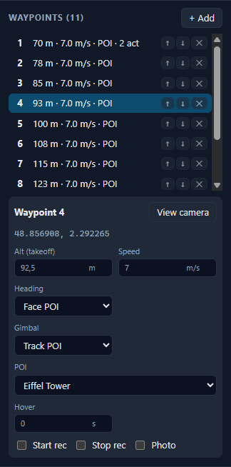
    </td>
    <td width="50%" valign="top">
      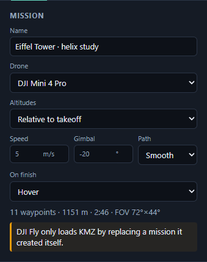
      <p>Each <b>waypoint</b> has its own altitude, speed, heading, gimbal, hover time and record or photo actions. <b>View camera</b> jumps the preview to that moment.</p>
      <p>The <b>mission</b> panel sets the drone, default speed and gimbal pitch, smooth or straight legs, the finish action, and how altitudes are measured:</p>
      <ul>
        <li><b>Relative to takeoff</b>, as Litchi and DJI expect</li>
        <li><b>Above ground (AGL)</b>, for terrain following</li>
        <li><b>WGS84 ellipsoid</b>, absolute</li>
      </ul>
      <p>Switching mode converts every waypoint without moving it.</p>
    </td>
  </tr>
</table>

Use **Undo/Redo** (`Ctrl+Z` / `Ctrl+Y`) freely: the mission autosaves, and **Save…** / **Open…** store it as a `.odc.json` file.

### 2. Aim the camera exactly

Every waypoint picks how the aircraft **turns** and how the gimbal **tilts**. The app blends between neighbouring waypoints with an ease-in/ease-out curve, so the camera never snaps.

| Heading        | What it does                                                                 |
| -------------- | ---------------------------------------------------------------------------- |
| **Along path** | The nose follows the direction of travel.                                    |
| **Face POI**   | The aircraft turns to keep the point of interest centred, all along the leg. |
| **Fixed**      | Holds a compass heading you set.                                             |

| Gimbal          | What it does                                              |
| --------------- | --------------------------------------------------------- |
| **Fixed pitch** | Holds a tilt angle, for example −20°.                     |
| **Track POI**   | Tilts continuously to keep the POI's aim height in frame. |

The POI tracking is computed for every frame of the flight, not only at the waypoints. Gimbal limits come from the drone profile.

### 3. Camera view and swappable screens

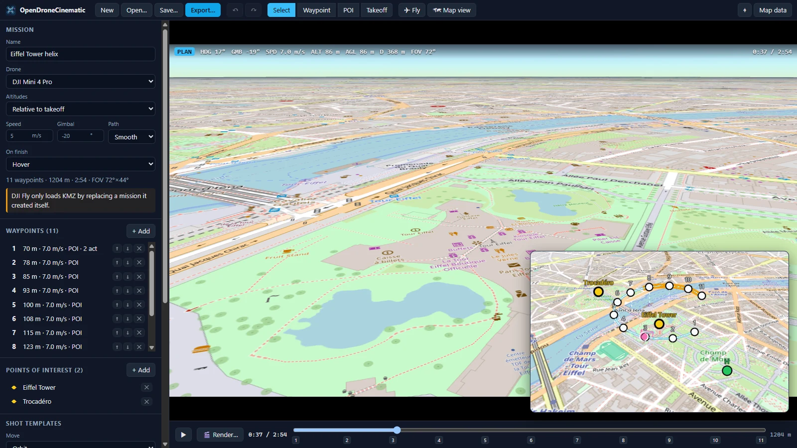

The **camera view** renders exactly what the drone camera will record. It uses the profile's horizontal field of view (72° for a 24 mm-equivalent lens), the video's 16:9 frame, and a rule-of-thirds overlay. The HUD shows heading, gimbal, speed, altitude, height above ground, distance from home, FOV and the sun (its height, and whether the shot is backlit, front-lit or side-lit, or the sun is in frame).

- Press **Tab**, click the mini-screen, or use **🎥 Camera view / 🗺 Map view** to swap the main screen and the mini-screen.
- Drag the mini-screen's top bar to move it, and its top-left corner to resize it. The layout is remembered.
- Press **L** or **▣ Mini-screen / ◫ Split** to show the map and camera side by side. **⬌ / ⬍** stacks them instead; drag the divider to resize, double-click it to centre.
- **🔍** sets the map's mouse-wheel zoom speed (slow, normal, fast or anything between), and **Snappy** stops the zoom as soon as the wheel stops.
- Press **Space** or ▶ to play the flight, and scrub the timeline. The numbered ticks on the timeline jump to each waypoint.

#### Light and time of day

The **Light** panel sets the shoot date, takeoff time and the location's UTC offset, saved with the mission (a new mission starts at today's evening golden hour). The map, the camera view and rendered video are lit by the real sun for that moment, and the sun moves as the timeline plays. The camera view and renders also draw shadows from terrain, buildings and 3D tiles; turn them off in the panel on slower machines.

- The **day strip** shows night, blue hour, golden hour and daylight; click it to set the takeoff time. The white mark is takeoff, the yellow mark the timeline cursor.
- 🌅, 🌇 and 🌆 jump to the morning golden hour, evening golden hour and blue hour (hover for their times).
- For each golden hour the panel says how the light falls on the shot, from the way the camera mostly faces: front-lit, backlit or side light.

Golden hour is when the sun is between 4° below and 6° above the horizon; blue hour from 6° to 4° below.

### 4. Fly mode: plan by flying

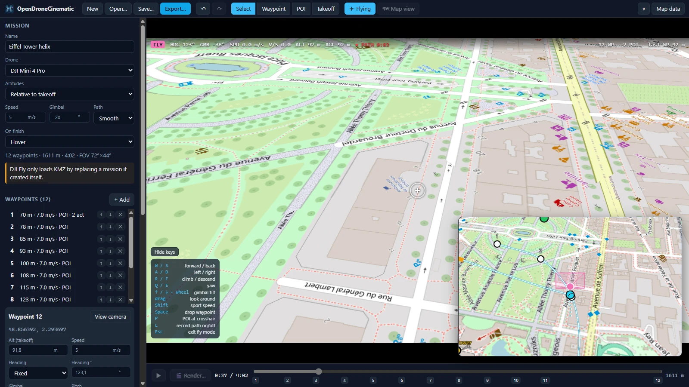

Press **F** (or **✈ Fly**) to take control of a virtual drone from the camera view, and scout the shot the way you'd fly it. It behaves like a drone in normal mode: it uses the profile's speed and climb limits, accelerates and brakes smoothly, hovers when you let go, and won't fly into terrain or buildings. The mini-map switches to a chase view behind the drone.

| Action                                                                | Keyboard / mouse         | Gamepad (Mode 2) |
| --------------------------------------------------------------------- | ------------------------ | ---------------- |
| Fly forward / back / sideways                                         | `W` `S` `A` `D`          | Right stick      |
| Climb / descend                                                       | `R` / `F`                | Left stick ↕     |
| Yaw                                                                   | `Q` / `E` or drag        | Left stick ↔     |
| Tilt gimbal                                                           | `↑` / `↓` or mouse wheel | `LT` / `RT`      |
| Sport speed                                                           | hold `Shift`             | hold `RB`        |
| **Drop a waypoint** at the current position, height, heading and tilt | `Space`                  | `A`              |
| **Mark a POI** where the crosshair hits terrain or buildings          | `P`                      | `B`              |
| **Record the flight path** (press again to stop)                      | `L`                      | `X`              |
| Exit fly mode                                                         | `Esc`                    |                  |

A recorded path is simplified into waypoints that keep your **position, camera yaw and gimbal tilt** within a couple of metres or degrees. Each leg keeps the speed you flew, and the spots where you paused become hovers.

### 5. Shot templates

<table>
  <tr>
    <td width="40%" valign="top">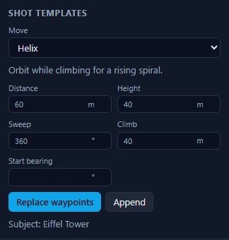</td>
    <td valign="top">
      <p>Select a POI, pick a move, set distance and height, and click <b>Replace waypoints</b> or <b>Append</b>. Waypoints get the real ground height under them.</p>
      <ul>
        <li><b>Orbit</b>: circle the subject at a constant height with the camera locked on</li>
        <li><b>Helix</b>: orbit while climbing</li>
        <li><b>Reveal</b>: fly toward the subject while the gimbal rises from the ground to the horizon</li>
        <li><b>Dolly / truck</b>: slide sideways past the subject</li>
        <li><b>Fly-by</b>: a straight pass while the camera pans to follow</li>
        <li><b>Dronie</b>: pull away and climb while keeping the subject framed</li>
      </ul>
    </td>
  </tr>
</table>

### 6. Survey grids for mapping

Open **Survey**, click **Draw area** (or press `G`) and click the corners of the area on the globe. Drag the green corners to adjust; undo removes the last one. Then set:

- **Height (AGL)**: sets the ground sample distance (GSD), shown live in cm/px for the selected drone's camera
- **Front / side overlap**: the spacing between photos along a line and between lines (75% / 65% by default)
- **Line angle**: or click **Auto** to run lines along the longest edge for the fewest turns
- **Overshoot**: extends lines past the outline so the edges are fully covered
- **Terrain follow**: adds a waypoint every _N_ metres along each line at the survey height above the ground, for hilly sites
- **Crosshatch**: flies a second grid at 90° for 3D reconstruction

**Generate waypoints** builds a serpentine of nadir lines with a fixed heading. Each line starts photos every _N_ metres at its first waypoint and stops them at its last, so the turns take no photos. The panel shows the area, GSD, line count, photo spacing and an estimated photo count, and warns when the photo interval is too fast for the camera.

Distance-triggered photos export as Litchi `photo_distinterval`, DJI WPML `multipleDistance` action groups and MAVLink `DO_SET_CAM_TRIGG_DIST`.

### 7. Safety checks

<table>
  <tr>
    <td width="40%" valign="top">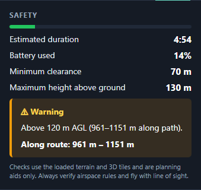</td>
    <td valign="top">
      <p>The app samples the ground under the whole path (terrain <i>and</i> 3D buildings) and re-checks the flight after every edit.</p>
      <ul>
        <li>🔴 Less than 10 m clearance over terrain or buildings</li>
        <li>🟠 Above 120 m AGL</li>
        <li>🟠 More than 1.5 km from takeoff</li>
        <li>🔴 Waypoint speed above the airframe limit; 🟠 climb or descent rate above its limit</li>
        <li>🔋 Battery estimate including transit from and back to takeoff, with a 25% reserve</li>
      </ul>
      <p>Problem sections are coloured on the 3D path. Clicking an issue jumps the timeline to it.</p>
    </td>
  </tr>
</table>

> [!NOTE]
> Clearance checks need real terrain, so add a free Cesium ion token (see [Map data](#map-data)). Airspace restrictions are **not** checked yet.

### 8. Export to your drone

<table>
  <tr>
    <td width="50%" valign="top">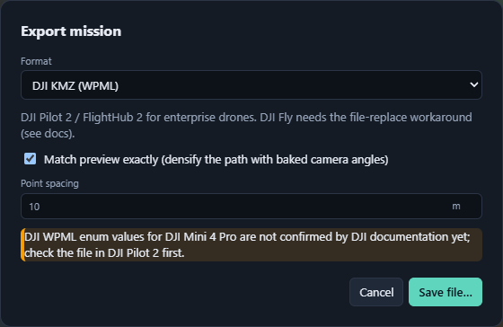</td>
    <td valign="top">
      <ul>
        <li><b>Litchi CSV</b>: import it in Litchi Mission Hub (heading mode: Custom). Supports POI focus, gimbal interpolation, curves and actions. Max 99 waypoints.</li>
        <li><b>DJI KMZ (WPML)</b>: works in DJI Pilot 2 and FlightHub 2 (M30, Mavic 3E, M350). Supports <code>towardPOI</code> headings, smooth gimbal moves and actions. DJI Fly needs a file-swap workaround.</li>
        <li><b>QGroundControl .plan</b> and <b>Mission Planner .waypoints</b>: MAVLink missions for PX4 and ArduPilot, with speed changes, ROI (POI) tracking, gimbal pitch, photos, video and distance-triggered survey photos.</li>
        <li><b>Match preview exactly</b>: replaces your waypoints with points every <i>N</i> metres along the previewed path, each with its exact heading and tilt baked in.</li>
      </ul>
      <p><b>Open…</b> also imports all four formats, so you can preview, check and convert missions made in other apps.</p>
      <p>See <a href="docs/exports.md">docs/exports.md</a> for the full mapping and known limits.</p>
    </td>
  </tr>
</table>

### 9. Render a previz video

<table>
  <tr>
    <td width="45%" valign="top">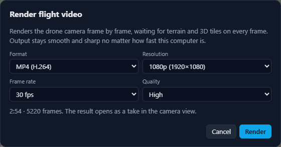</td>
    <td valign="top">
      <p><b>🎬 Render…</b> creates a video of the drone camera <b>frame by frame</b>. It waits for terrain, imagery and 3D tiles on every frame, so the output is smooth and sharp on any computer.</p>
      <ul>
        <li><b>MP4 (H.264)</b>, <b>WebM (VP9)</b> or <b>GIF</b> (up to 640 px wide and 15 fps)</li>
        <li>720p, 1080p, 1440p or 4K at 24–60 fps, in three quality levels</li>
      </ul>
    </td>
  </tr>
</table>

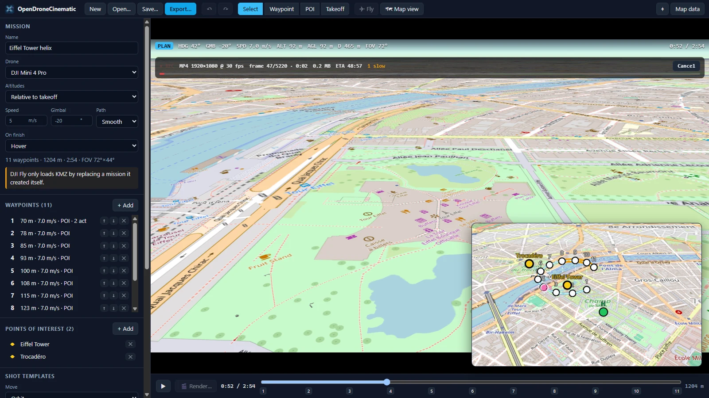

While it renders, a **REC overlay** shows the frame count, file size, time remaining and any frames where tiles were slow to load. You can cancel at any time.

### 10. Takes and side-by-side compare

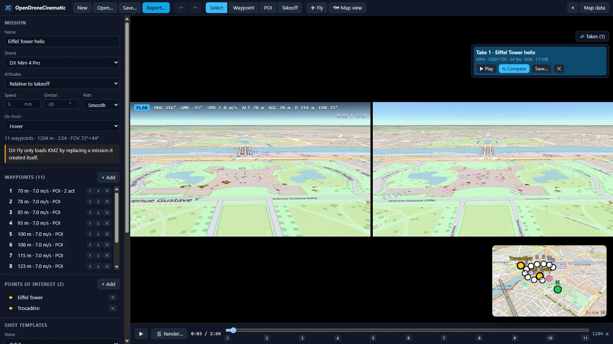

Every render becomes a **take** that plays right inside the camera view. Open **🎞 Takes** to replay, save or delete a take, or click **⇆ Compare** to play it side by side with the live 3D view. Both sides follow the timeline, so you can change the plan and see the difference straight away.

### Drone profiles

47 profiles, grouped by app in the **Drone** picker. Each sets the camera (field of view and ground sample distance), speed and climb limits, flight time and gimbal range.

| Group                        | Models                                                                                                                                            | Exports                      |
| ---------------------------- | ------------------------------------------------------------------------------------------------------------------------------------------------- | ---------------------------- |
| DJI consumer (DJI Fly)       | Mini 2 / SE, Mini 3, Mini 3 Pro, Mini 4 Pro, Mini 5 Pro, Air 2, Air 2S, Air 3, Air 3S, Mavic 3 / Classic / Cine, Mavic 3 Pro, Mavic 4 Pro         | Litchi¹, DJI KMZ²            |
| DJI consumer, previz only    | Mini 4K / Mini 2 SE, Lito 1, Lito X1, Flip, Neo, Avata 2                                                                                          | none (no waypoint API)       |
| DJI enterprise (DJI Pilot 2) | Mavic 3E / 3T / 3M, Matrice 3D / 3TD, Matrice 4E / 4T / 4D / 4TD, Matrice 30 / 30T, Matrice 300 RTK (H20, P1), Matrice 350 RTK (H20, H30, P1, L2) | DJI KMZ³                     |
| DJI enterprise, other apps   | Inspire 3, Phantom 4 RTK                                                                                                                          | none                         |
| DJI older (DJI GO 4)         | Mavic 2 Pro, Mavic 2 Zoom, Mavic Pro, Mavic Air, Spark, Phantom 4 / Advanced, Phantom 4 Pro / V2.0, Inspire 2 + X5S                               | Litchi                       |
| Open autopilots              | ArduPilot / PX4 multirotor                                                                                                                        | QGC `.plan`, Mission Planner |
| Custom                       | your own lens, speed and battery                                                                                                                  | all                          |

¹ Only for drones Litchi supports. ² DJI Fly has no KMZ import: replace a mission it created (see [docs/exports.md](docs/exports.md)). The Mini 4 Pro enum value is community-sourced; other DJI Fly drones fall back to a generic one, with a warning. ³ Enum values for the M300, M350, M30, Mavic 3 enterprise and Matrice 3D series match DJI's Cloud API. Matrice 4, H30 and L2 values are not yet confirmed and the export says so. Specs for the Lito 1 and Lito X1 come from early reviews. Please help verify.

### Map data

Without a token the app shows OpenStreetMap on flat terrain, which is what the screenshots above use. For real terrain, aerial imagery and 3D buildings:

1. Create a free account at [ion.cesium.com](https://ion.cesium.com/).
2. Copy your default access token.
3. Paste it in **Map data**. The token is stored only on your computer.

To work offline or with better local data, pick **Terrain → GeoTIFF DEM (local)** and load a single-band elevation GeoTIFF in WGS84 (EPSG:4326), Web Mercator or UTM. Most DEMs are heights above sea level, so set **Height offset** to the local geoid height (about +48 m in central Europe) to get WGS84 heights. Reproject other coordinate systems first, for example with `gdalwarp -t_srs EPSG:4326 in.tif out.tif`.

Under **Your own 3D Tiles** you can add photogrammetry or scans exported as 3D Tiles. In the browser, give a URL. In the desktop app, you can also browse to a local folder.

---

## 🚀 Getting started

### Download

Installers for Windows (`.exe`, `.msi`), macOS (`.dmg`) and Linux (`.AppImage`, `.deb`) are attached to each [GitHub Release](../../releases). The **Release** workflow builds them whenever a `v*` tag is pushed. The app isn't code-signed yet, so Windows SmartScreen may ask you to confirm with **More info → Run anyway**.

### Build from source

You need [Node.js 22+](https://nodejs.org/). For the desktop app you also need [Rust](https://rustup.rs/) and the [Tauri prerequisites](https://v2.tauri.app/start/prerequisites/).

```bash
npm install
```

Run in the browser, the fastest way to try it:

```bash
npm run dev
```

Then open <http://localhost:1420>.

Run it as a desktop app:

```bash
npm run tauri dev
```

Build installers for your OS:

```bash
npm run tauri build
```

---

## ⌨️ Keyboard shortcuts

| Key   | Action        | Key                 | Action              |
| ----- | ------------- | ------------------- | ------------------- |
| `V`   | Select tool   | `Space`             | Play / pause        |
| `W`   | Add waypoints | `Tab`               | Swap camera / map   |
| `P`   | Add POI       | `F`                 | Fly mode            |
| `T`   | Set takeoff   | `Del`               | Delete selected     |
| `G`   | Draw survey   | `L`                 | Split / mini-screen |
| `Esc` | Cancel / exit | `Ctrl+Z` / `Ctrl+Y` | Undo / redo         |

---

## 🧩 Project layout

```
apps/desktop/          Tauri 2 + React app (src/ is the UI, src-tauri/ is the Rust shell)
packages/core/         Pure TypeScript: geodesy, mission model, spline path and timing,
                       camera maths, drone profiles, safety, shot templates, flight sim,
                       survey grids, DEM sampling and UTM maths
packages/exporters/    Litchi CSV, DJI WPML/KMZ, QGC .plan and Mission Planner writers and
                       importers, with golden-file and round-trip tests
packages/cesium-view/  CesiumJS: data sources, mission rendering, picking, ground sampling,
                       camera view and the offline frame renderer
docs/                  Architecture, export notes, logo and screenshots
```

`core` and `exporters` never import Cesium, so they run and test in plain Node. The design is explained in [docs/architecture.md](docs/architecture.md).

```bash
npm test            # unit and golden-file tests (Vitest)
npm run typecheck   # TypeScript across all packages
npm run format      # Prettier
```

If you change an exporter on purpose, update its golden files with `npx vitest run -u` and review the diff.

## 🗺️ Roadmap

- [x] **M1: cinematic planning.** Waypoints, POIs, camera preview, templates, safety, Litchi and DJI export, fly mode, video renders
- [x] **M2: mapping and more drones.** Survey grids (polygon, overlap, GSD), QGroundControl `.plan` / MAVLink export, GeoTIFF terrain, importing KMZ, Litchi and `.plan` files
- [ ] **M3: polish.** Airspace overlays, signed installers with auto-update, a plugin API for exporters

## 🤝 Contributing

Contributions are very welcome! Especially wanted:

- Verified DJI enum values for consumer drones
- Real-world flight test reports
- New drone profiles
- New exporters

See [CONTRIBUTING.md](CONTRIBUTING.md).

## 📄 License

[MIT](LICENSE) © OpenDroneCinematic contributors.

CesiumJS is Apache-2.0. Map data comes from its providers under their own terms. Screenshot map data © [OpenStreetMap](https://www.openstreetmap.org/copyright) contributors.
