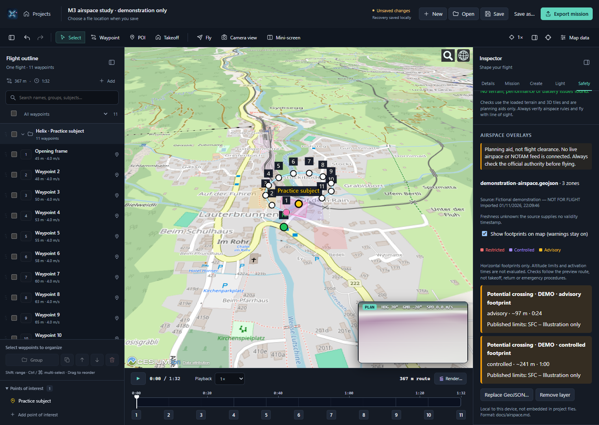
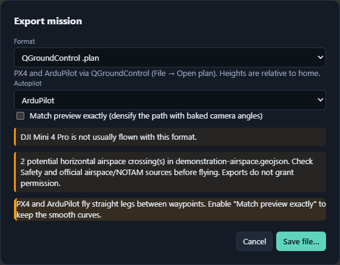
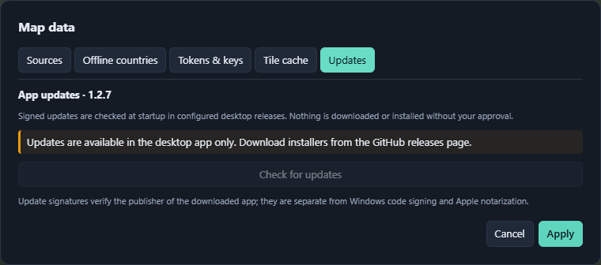

# M3: final major update

Status: **draft validation for v1.3.0**. The initial implementation covers all three roadmap tracks without claiming production readiness. The maintainer has configured the updater settings in GitHub; real signed artifacts and upgrade behavior still need validation.

## Implemented

- Local [airspace overlays](airspace.md): strict GeoJSON import, IndexedDB persistence, category colors, map visibility independent from warnings, source/freshness disclosure, and cancellable background footprint checks.
- [Exporter plugin API v1](exporter-plugins.md): versioned registry, declarative controls, validated async text/binary exports, isolated mission snapshots, and all four built-ins migrated without changing their output.
- [Signed-update plumbing](releases.md): Tauri updater/process integration, startup/manual checks, consent/progress/retry UI, saved-work/install guards, and key-gated updater signatures. Windows publisher signing and Apple notarization are intentionally out of scope; macOS uses ad-hoc signing.

## Still required before completion

- Real signature-verified upgrades and installer validation on Windows, macOS (both architectures) and Linux, using the maintainer's configured updater keys. Paid OS-signing certificates and notarization are not completion requirements.
- Regulatory-data provider/licensing decisions if live or bundled country coverage is desired. Current overlays are explicitly user-supplied, horizontal-only, not a NOTAM service or authorization engine.
- Real exporter-extension integration and target ground-control/aircraft validation. Runtime marketplace/loading and sandboxing are not part of API v1.
- UI/accessibility review and safe-area regression testing of the existing flight-planning/export workflows.

The maintainer has authorized committing/pushing M3 and preparing an **unpublished v1.3.0 draft release**. Credentials are not generated or committed, and aircraft safety thresholds are unchanged. Publishing the draft requires separate approval.

## Initial-pass validation

Validated on Windows:

- `npm test`: 238 tests passing, including the existing exporter golden files and updater-only release configuration tests.
- `npm run typecheck`, `npm run format:check`, `npm run build`: passing.
- `cargo check` and `cargo test --locked --lib` for the desktop shell: passing (2 native tests).
- Headless Edge browser smoke: GeoJSON import and background route checks, warnings with map footprints hidden, persisted reload, QGC options/download, rejection of obsolete async exporter results, and browser-only update gating. No page errors.

This is not a signed cross-platform upgrade test or real-aircraft validation.

## UI preview

These screenshots use **fictional airspace data and a demonstration mission**, with OpenStreetMap imagery on flat terrain. They are not flight-ready and do not depict real regulatory boundaries. Map data © [OpenStreetMap contributors](https://www.openstreetmap.org/copyright).

The export dialog's format-specific controls now come from the exporter registry:

The browser makes the desktop-only update limitation explicit:

