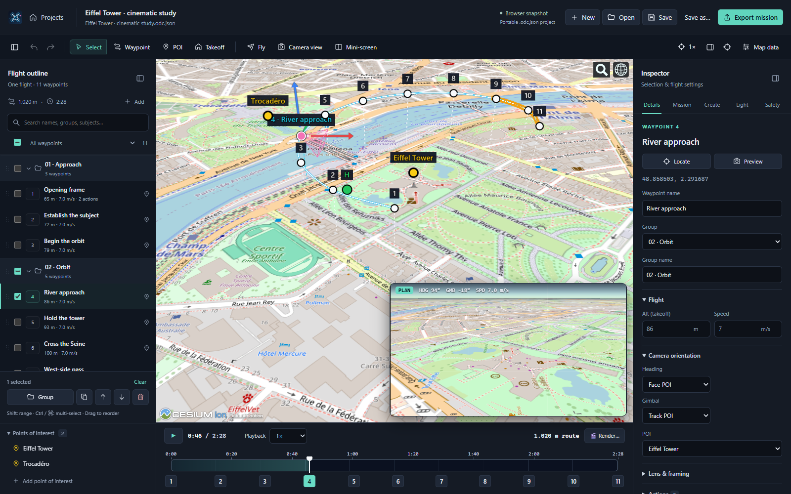
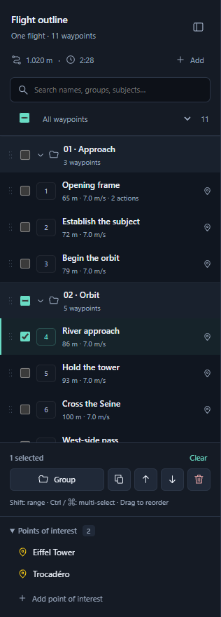
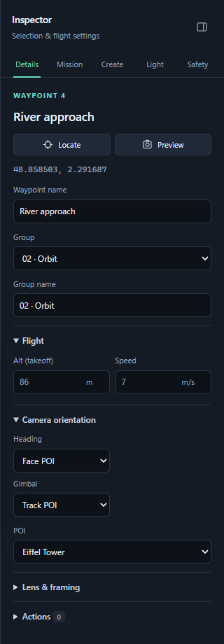

# Organizing a flight

The planner has three work areas: **Flight outline** on the left, the map and camera in the center, and **Inspector** on the right. Use the panel buttons in the toolbar to collapse either side; the app remembers that preference.

<b>A closer look at the outline and inspector</b>

<table>
  <tr>
    <td width="50%" valign="top"></td>
    <td width="50%" valign="top"></td>
  </tr>
</table>

## Names and groups

- Select a waypoint and edit **Waypoint name** under **Details**. Enter or leaving the field commits the name as one undo step; Escape cancels the edit.
- Check several waypoints, click **Group**, enter a name, and choose **Create**. Generated shots and surveys automatically receive a named group.
- Rename a group in **Details → Group name**. **Group** assigns the selection to another group; choose **Ungrouped** to remove membership. Empty groups disappear automatically.
- Grouping and naming preserve flight order. If a group has separated sections, the outline shows it again as **Continued**, in the actual route position. Collapsing a group hides all its sections in the outline.
- Names and groups are stored in `.odc.json` projects and recovery drafts. Existing projects open without conversion. Exported missions follow waypoint order, with the same flight settings and actions as before.

## Reorder and edit together

Drag the dotted handle beside a waypoint to move it. Dragging a selected waypoint moves the selection as one block, preserving its relative flight order. The insertion line shows the destination. A waypoint drop joins the destination group; dropping at the end of the flight makes it ungrouped.

Drag a group handle to move **all its waypoints** together, including filtered-out members. Group drops keep their names and memberships and land at group boundaries. **Move up / down** buttons offer a keyboard-accessible alternative; each selected run moves past one neighboring waypoint. All changes update the actual flight order and are undoable.

The outline footer offers **Group**, **Duplicate**, **Move up**, **Move down**, and **Delete**. Duplicate inserts copies after the last selected waypoint and selects the copies. Copies keep flight settings and actions and receive new IDs.

The inspector displays shared values for a selection. **Mixed** means values differ. Only edited fields are applied to all selected waypoints. Flight and camera orientation are immediately available; lens controls and actions expand when needed.

## Find and select

Search by waypoint number, name, group, tracked subject, or action. The filter menu includes named groups, waypoints with actions, POI tracking, and ungrouped waypoints.

- Row checkboxes toggle individual waypoints. Group checkboxes toggle matching members of that group.
- The header checkbox selects all matching waypoints, including collapsed ones.
- Ctrl/⌘-click toggles selection. Shift-click selects a range; in a filtered view it selects only matching waypoints.
- Existing selections survive filtering. The footer explicitly counts selected waypoints outside the filter; bulk changes also affect those selections. **Clear** deselects everything. **Reveal** clears filters to show the active waypoint.
- Search and filters expand matching groups temporarily. Reordering always changes the full flight, even while filtering.

## Connect outline, map and camera

Selecting on the map or timeline reveals the waypoint in the outline and opens its inspector. If a filter hides it, use **Reveal**. Double-click a waypoint or POI to locate it on the map. **Locate** centers the map; **Preview** opens the camera at that waypoint's arrival time and pauses playback.

The outline renders only visible rows plus a small buffer, so a 2,000-waypoint mission does not create 2,000 row controls. Timeline markers thin out according to the available width, retaining the active waypoint. For missions above 100 waypoints, map badges show the active waypoint and ground stems show small selections, keeping dense surveys readable. Every waypoint remains available through the outline and map selection.

## Keyboard

With focus in the ordered waypoint list:

| Shortcut           | Action                                                                 |
| ------------------ | ---------------------------------------------------------------------- |
| ↑ / ↓, Home / End  | Select and reveal the previous, next, first, or last expanded waypoint |
| Shift + ↑ / ↓      | Extend selection                                                       |
| Ctrl/⌘ + A         | Select all matching waypoints                                          |
| Ctrl/⌘ + D         | Duplicate the selection                                                |
| Alt + ↑ / ↓        | Move the selection up or down                                          |
| Delete / Backspace | Delete selected waypoints                                              |
| Escape             | Clear selection or cancel dragging                                     |

**Ctrl/⌘ + Z** undoes an edit; **Ctrl/⌘ + Shift + Z** redoes it. The inspector's tabs support Left/Right arrows and Home/End. Group expanders and action buttons also work with the keyboard.

The screenshots show an Eiffel Tower cinematic study using OpenStreetMap with terrain disabled.
